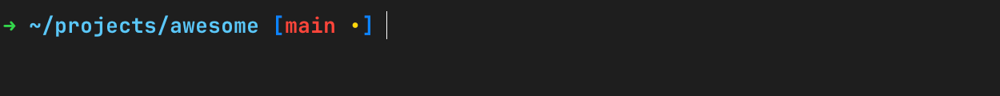

# ZSH Theme
[](LICENSE)



A simple and minimalistic ZSH theme tailored to my personal workflow.
It provides a compact, clean prompt showing the last command's exit status and the current working directory.
When inside a Git repository, it displays the active Git reference (branch, tag or commit hash), automatically truncating long branch names.
An indicator appears when there are uncommitted changes, keeping the prompt informative without clutter.


## Contents
- [Prompt](#prompt)
- [Requirements](#requirements)
- [Installation](#installation)
- [Updating](#updating)
- [Uninstallation](#uninstallation)
- [Troubleshooting](#troubleshooting)
- [Contributing](#contributing)
- [Credits](#credits)

## Prompt
```
➜ ~/projects/zsh-theme [main •]
```

| Part | Meaning |
|------|---------|
| `➜` | Status of the previous command: green when it succeeded, red when it failed |
| `~/projects/zsh-theme` | Current working directory, with `~` for the home directory |
| `[main]` | Git reference, only inside a Git repository: the branch name, or the tag name when `HEAD` is detached at a tag, or the short commit hash otherwise |
| `[this-is-a-very…]` | References longer than 15 characters are truncated with `…` |
| `•` | The repository has uncommitted changes (modified, staged or untracked files) |

## Requirements
- [ZSH](https://www.zsh.org) with the `vcs_info` module (included in every standard ZSH build).
- [Git](https://git-scm.com) for the Git reference and the changes indicator.
- A terminal font that contains the `➜`, `•` and `…` characters (most modern fonts do; no patched or Nerd Font needed).

## Installation
Select and follow the installation instructions for a shell framework of your choice.

<details>
    <summary>Plain (without a framework)</summary>

### Without Framework
1. Download the theme file `zsh-theme.zsh` to any directory.
The following command downloads the theme as the `~/.zshrc.vstelmakh.plugin.zsh` file:
```shell
curl -fL# --create-dirs \
    -o "${HOME}/.zshrc.vstelmakh.plugin.zsh" \
    "https://raw.githubusercontent.com/vstelmakh/zsh-theme/main/zsh-theme.zsh"
```

2. Source the theme in the `~/.zshrc` file.
The following command adds the `source` line to the `~/.zshrc` file:
```shell
echo -e "\nsource ${HOME}/.zshrc.vstelmakh.plugin.zsh\n" >> "${HOME}/.zshrc"
```

3. Restart your terminal or run `source ~/.zshrc` to apply the changes.
</details>

<details>
    <summary>Oh My ZSH</summary>

### Oh My ZSH
1. Download the theme file `zsh-theme.zsh` to the Oh My ZSH custom themes directory.
The following command downloads the theme to that directory with the name `vstelmakh.zsh-theme`:
```shell
curl -fL# --create-dirs \
    -o "${ZSH_CUSTOM:-${ZSH}/custom}/themes/vstelmakh.zsh-theme" \
    "https://raw.githubusercontent.com/vstelmakh/zsh-theme/main/zsh-theme.zsh"
```

2. Set `ZSH_THEME="vstelmakh"` in the `~/.zshrc` file.
The following command updates the existing `ZSH_THEME` line:
```shell
sed -i.bak -E 's/^([[:space:]]*ZSH_THEME=).*/\1"vstelmakh"/' "${HOME}/.zshrc" && rm "${HOME}/.zshrc.bak"
```

3. Restart your terminal or run `source ~/.zshrc` to apply the changes.
</details>

Run the commands in your ZSH session: they use variables such as `$ZSH` and `$ZSH_CUSTOM` that are only set there.

## Updating
The theme is a single file, so updating means downloading it again.
Run the download command (step 1) of your installation method once more; it overwrites the existing file.
Then restart your terminal or run `source ~/.zshrc`.

## Uninstallation
Select and follow the uninstallation instructions for the shell framework used during installation.

<details>
    <summary>Plain (without a framework)</summary>

### Without Framework
1. Remove the theme `source` line from the `~/.zshrc` file.
The following command removes the line:
```shell
sed -i.bak -E '/^source .*\/\.zshrc\.vstelmakh\.plugin\.zsh$/d' "${HOME}/.zshrc" && rm "${HOME}/.zshrc.bak"
```

2. Delete the theme file.
The following command deletes the `~/.zshrc.vstelmakh.plugin.zsh` file:
```shell
rm "${HOME}/.zshrc.vstelmakh.plugin.zsh"
```

3. Restart your terminal to apply the changes.
</details>

<details>
    <summary>Oh My ZSH</summary>

### Oh My ZSH
1. Set your previous theme in the `~/.zshrc` file.
The following command sets the theme to the Oh My ZSH default `robbyrussell`; replace it with your previous theme if needed:
```shell
sed -i.bak -E 's/^([[:space:]]*ZSH_THEME=).*/\1"robbyrussell"/' "${HOME}/.zshrc" && rm "${HOME}/.zshrc.bak"
```

2. Delete the theme file from the Oh My ZSH custom themes directory.
The following command deletes the `vstelmakh.zsh-theme` file:
```shell
rm "${ZSH_CUSTOM:-${ZSH}/custom}/themes/vstelmakh.zsh-theme"
```

3. Restart your terminal to apply the changes.
</details>

## Troubleshooting

<details>
    <summary>The theme is not applied (Oh My ZSH)</summary>

- Check that `~/.zshrc` contains exactly one `ZSH_THEME=` line and that it comes before `source $ZSH/oh-my-zsh.sh`.
- Check that the file is named `vstelmakh.zsh-theme` and is in the custom themes directory: `ls "${ZSH_CUSTOM:-${ZSH}/custom}/themes"`.
- Run `echo $ZSH_THEME` in a new terminal; it should print `vstelmakh`.
</details>

<details>
    <summary>Errors like <code>command not found: ^M</code> or <code>parse error near `return'</code></summary>

The theme file has Windows (CRLF) line endings, usually because the repository was cloned on Windows with `core.autocrlf=true`.
Download the file with the `curl` command from the installation instructions instead, or convert it (plain installation path shown):
```shell
tr -d '\r' < "${HOME}/.zshrc.vstelmakh.plugin.zsh" > "${HOME}/.zshrc.vstelmakh.plugin.zsh.tmp" \
    && mv "${HOME}/.zshrc.vstelmakh.plugin.zsh.tmp" "${HOME}/.zshrc.vstelmakh.plugin.zsh"
```
</details>

<details>
    <summary>The prompt is slow in large repositories</summary>

Before every prompt the theme runs `git status` to show the changes indicator.
In very large repositories (or on network drives) this can take noticeable time, because Git scans the working tree, including untracked files.
Git's own settings can speed it up. Run them inside the slow repository:
```shell
git config core.untrackedCache true  # cache the untracked files scan
git config core.fsmonitor true       # built-in file system monitor, macOS and Windows only
```
</details>

<details>
    <summary>Symbols are shown as boxes or question marks</summary>

The terminal font does not contain `➜`, `•` or `…`.
Switch to a font that includes them, for example any recent version of the default monospace font of your operating system.
</details>

## Contributing
Contributions are welcome - especially bug fixes and improvements to stability.
However, not all changes may be accepted, as the goal is to keep the theme simple and aligned with my personal preferences.
If you are looking for additional styling options or customizations, please fork the repository and adapt the theme to your needs.

## Credits
[Volodymyr Stelmakh](https://github.com/vstelmakh)  
Licensed under the MIT License. See [LICENSE](LICENSE) for more information.  
